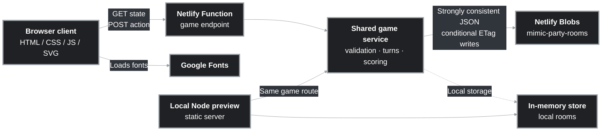

# MIMIC

## Overview

- **One-liner:** A 2-8 multiplayer hide-and-seek party game where players hide and search for a small mech named Mimi in illustrated scenes and photos.
- **Purpose:** Provides a lightweight, browser-based social game that lets friends create or join a room, take turns hiding Mimi, and compete to find her quickly.
- **Status:** finished. 
- **Live URL:** https://hidemimi.netlify.app/
- Note: This project was made for Handshake and OpenAI's "Create a Multiplayer Game" challenge using ChatGPT Work. Majority of the code is written by ChatGPT, with key design decisions made by me. This is by far the most I've relied on AI for a project since that was the purpose of the challenge.

## Features

- Create a private room or join an existing room with a five-character code.
- Join an available public room with “Play now.”
- Share a room invite link.
- Support 2–8 players, ready checks, host controls, visibility changes, and lobby removal of players.
- Take turns hiding Mimi in a randomly selected scene.
- Move Mimi, choose a small/medium/large size, paint or erase paint, sample a scene color, and lock in the hiding spot.
- Pan and zoom the scene up to 6× while searching.
- Seekers submit guesses with a 750 ms cooldown and receive points based on finding order and remaining time.
- Hider receives points based on search time, missed seekers, color score, and Mimi size.
  - Color score: A color counts at S ≥8%, M ≥6%, or L ≥4% of Mimi’s total area. Each meaningful visible color earns its closest other color’s CIELAB ΔE distance, capped at 20. This is to reward flexible color usage, as it makes camouflage more challenging. Having only one color earns you 0. Mimi's inherent colors count where paint doesn’t cover her. In short, more colors = more score.
- Show reveal/results screens and support rematches.
- Continue a room when a player leaves by reassigning the host or skipping a departed hider.
- Try being a hider with the local interactive practice scene on the home page.

## Tech Stack

| Layer | Technology | Notes |
|---|---|---|
| Language(s) | JavaScript (ES modules), TypeScript | Browser and Node.js code is JavaScript; the Netlify Function entrypoint is TypeScript. |
| Frontend | HTML, CSS, browser JavaScript, SVG | No frontend framework or bundler is used. `public/` is copied to `dist/` for deployment. |
| Backend | Netlify Function running Node.js | `netlify/functions/game.ts` delegates game behavior to the shared `src/game-service.mjs` module. |
| Database | Netlify Blobs | Room records are JSON blobs in the `mimic-party-rooms` store. Local development uses an in-memory compatible store instead. |
| Auth | None | Players receive random UUIDs stored in `sessionStorage`; there is no account system or durable identity verification. |
| Key libraries | `@netlify/blobs` 11.1.4 | Reads, lists, writes, deletes, and conditionally updates room blobs in production. Other functionality uses Node.js and browser built-ins. |
| External APIs/services | Netlify Functions and Netlify Blobs; Google Fonts | Netlify provides the serverless runtime and storage. `public/styles.css` imports DM Sans, DM Mono, and Space Grotesk from Google Fonts. No other runtime API is configured. |

## Architecture



In production, the browser loads static assets from Netlify and sends `GET` requests to retrieve room state and `POST` requests for room creation, joining, lobby actions, hiding actions, and guesses. The Netlify Function creates a strongly consistent Netlify Blobs store and passes it to the shared game service. The service validates each action, advances time-based phases, and serializes the room as a JSON blob. Mutations use read/modify/conditional-write retries with an ETag so concurrent player actions do not blindly overwrite one another. The browser polls the endpoint approximately every 650 ms and stores only its room code and player ID in `sessionStorage`.

## File Structure

```text
.
├── public/
│   ├── index.html              Static application shell and metadata.
│   ├── app.js                  Browser UI, polling, gestures, room actions, rendering, and scoring display.
│   ├── game-config.js          Shared timing, limits, scoring, paint, placement, and zoom tuning.
│   ├── scenes.js               Scene artwork and SVG rendering helpers for Mimi and paint.
│   ├── styles.css              Responsive visual design, controls, game screens, and accessibility states.
│   └── scenes/                 Local raster scene assets used by the frontend.
├── src/
│   ├── game-service.mjs        Room lifecycle, validation, game phases, guesses, scoring, and public state shaping.
│   └── local-blob-store.mjs    In-memory Netlify Blobs-compatible store for local preview.
├── netlify/
│   └── functions/game.ts       Production Netlify Function adapter using Netlify Blobs.
├── scripts/
│   ├── build.mjs               Copies public/ into dist/ for the static Netlify publish directory.
│   └── local-server.mjs        Node HTTP server for static files and the local game endpoint.
├── server.mjs                  Local preview entrypoint that imports scripts/local-server.mjs.
├── netlify.toml                Netlify build, publish, Function directory, bundler, and Node version settings.
├── package.json                Package metadata, scripts, Node engine, and Netlify Blobs dependency.
├── package-lock.json           Locked npm dependency versions.
└── .gitignore                  Excludes dependencies, build output, Netlify output, logs, and caches.
```

## Data Model

There is no relational database schema. Each room is stored as one JSON document under the `rooms/` key prefix in Netlify Blobs.

- **Room:** code, visibility, lifecycle status, host, round counters, current hider, scene, target, deadlines, scores, and result metadata.
- **Player:** random ID, display name, host/ready state, cumulative score, hiding/searching state, guess timing, and rematch preference.
- **Target:** normalized `x`/`y` placement, selected size, and bounded paint strokes.
- **Paint stroke:** color, brush width, erase flag, and bounded SVG points.
- **Round score breakdown:** hider score inputs, seeker times, misses, color-distance analysis, and per-seeker points.

Relationships are embedded in the room document: a room contains many players; a room has one current target and one current hider; each player can become the hider for one round. The game ends when everyone has been a hider.

## How to Run Locally

1. **Prerequisites:** Node.js 20 or newer. `netlify.toml` pins Netlify builds to Node.js 22.12.0, but `package.json` requires only Node.js `>=20`.
2. **Install:**

   ```sh
   npm install
   ```

3. **Environment variables:** None are required by the repository. `PORT` is optional and changes the local preview port from its default of `4173`. Production Netlify Blobs configuration is provided by the Netlify runtime; no secret values are present in the repo.
4. **Start commands:**

   ```sh
   npm start
   ```

   Open `http://localhost:4173`. The local server serves `public/`, exposes the same `/.netlify/functions/game` route, and stores rooms only in memory. Rooms reset when the process stops. `npm run dev` is an alias for the same command.
5. **Build:**

   ```sh
   npm run build
   ```

   This removes and recreates `dist/` by copying `public/`.
6. **Tests:** No test files or test script are defined in the repository. Manual verification requires opening the local app in multiple browser profiles or private windows and exercising room creation, joining, ready/start, hiding, searching, leaving, and rematching.

## Deployment

- **Current:** Netlify static hosting plus a Netlify Function at `/.netlify/functions/game`. The build command is `npm run build`; the publish directory is `dist`; Functions are discovered from `netlify/functions`; and Netlify uses esbuild for the TypeScript Function. Netlify build Node version is `22.12.0`. The Function stores rooms in the strongly consistent `mimic-party-rooms` Netlify Blobs store. The configured domain is hidemimi.netlify.app.
- **Target (AWS):** In the future for extra practice. A reasonable target would be static assets in S3 behind CloudFront, an API implemented with Lambda and API Gateway, and room documents in DynamoDB using conditional writes. That would require replacing the Netlify Function adapter, Netlify Blobs calls, and Netlify-specific deployment configuration.
- **Dependencies to migrate:** Netlify Function runtime, Netlify Blobs room storage, strong consistency behavior, conditional ETag writes, room expiration metadata, and the Netlify build/publish configuration. Google Fonts is an external frontend dependency and could remain external or be self-hosted.

## Key Decisions & Tradeoffs

- **Vanilla browser JavaScript instead of a frontend framework:** Keeps the game small, portable, and easy to deploy as static files, at the cost of a large stateful UI module and less framework-level structure.
- **Netlify Function plus Netlify Blobs:** Provides a low-operations backend and persistence without a separately managed server or database. It couples room storage and deployment to Netlify and is not directly portable to AWS.
- **Polling instead of WebSockets:** A roughly 650 ms poll is simple and works with serverless requests, but it increases request volume and makes updates less immediate than a push-based connection, creating short delays.
- **Shared tuning configuration:** `public/game-config.js` is imported by both browser and server code so timing, limits, hit areas, and scoring stay aligned. This also means server-side behavior depends on a frontend-directory module.
- **Optimistic concurrency with conditional writes:** ETag-based compare-and-swap updates protect room state from simultaneous actions, but retries and serialized whole-room JSON writes may become a bottleneck at larger scale.
- **Anonymous UUID-based sessions:** Makes joining smooth, but provides no identity recovery, moderation history, or protection against impersonating a stored player ID, but these are unlikely to be an issue for a casual browser game.
- **Bounded game state:** Request size, paint points/strokes, player count, room lifetime, and placement ranges are explicitly limited to reduce abuse and keep room documents small.

## Known Issues / Tech Debt

- No automated unit, integration, browser, or load tests are included.
- No CI workflow, Dockerfile, infrastructure-as-code, observability, analytics, or documented rollback procedure is included.
- CORS allows `*`, and the endpoint has no rate limiting, abuse prevention, authentication, or explicit origin restriction.
- Room polling and whole-room conditional JSON writes may become inefficient with many concurrent players or rooms.
- `public/app.js` is a large monolithic client module, which makes feature-level testing and maintenance harder.

## What I Learned

- Designing a multiplayer state machine with lobby, hiding, searching, reveal, and finished phases.
- Using server-authoritative validation so clients cannot directly award scores or reveal hidden state early.
- Applying optimistic concurrency control and conditional writes to coordinate simultaneous serverless requests.
- Modeling time-based gameplay with deadlines and advancing state when clients poll.
- Building touch-friendly SVG interactions, including pan/zoom, pointer gestures, painting, erasing, and scene color sampling.
- Keeping gameplay constants shared between client and server.
- Deploying a static frontend and serverless backend with Netlify Functions and Netlify Blobs.
- Handling edge cases in multiplayer gameplay such as player departure, host reassignment, incomplete rounds, and rematches without requiring permanent accounts.

## Resume Blurb

- Built a mobile-first multiplayer hide-and-seek party game supporting 2–8 players, room creation/joining, rotating hider turns, timed searches, guesses, scoring, and rematches.
- Implemented a server-authoritative Node.js game service with Netlify Functions and strongly consistent Netlify Blobs, including validation, 12-hour room expiration, and ETag-based conditional-write retries for concurrent actions.
- Created a responsive vanilla JavaScript/SVG interface with touch pan/zoom, interactive painting and erasing, scene color sampling, six scenes, and a local preview environment that mirrors the production API route.
